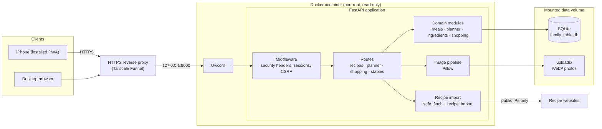

# Family Table

A self-hosted recipe box, weekly meal planner, and shared shopping list for a household. It runs on a home computer, installs on iPhones as an app, and keeps every recipe, plan, and photo in one SQLite file the family owns.


## The problem

Our recipes were spread across bookmarks, screenshots, and cookbooks. Planning the week's dinners and writing a grocery list took an evening, and two people shopping from two copies of a list meant duplicate or missed items.

Family Table brings it together:

1. **Save recipes** by typing them in or pasting a link from a recipe website.
2. **Plan the week** by dragging dinners onto days.
3. **Add each dinner's ingredients** to one shared list, choosing what you actually need, with pantry staples left unchecked.
4. **Cook with help**: scale tonight's dinner for more people and ask a local AI cooking assistant about the recipe.
5. **Shop together**: items ticked off on one phone disappear from the other within seconds.

## Features

| Area | Highlights |
|---|---|
| **Recipes** | Photos, categories, search, ingredient checklist, cooking steps, and signed notes from family members |
| **Recipe import** | Paste a URL; the form is pre-filled from the page's schema.org data for review before saving. Downloads go through an SSRF-safe fetcher |
| **Meal planning** | Monday–Sunday board with drag-and-drop (mouse and touch), swapping, and past/future weeks. A dinner leaves the board at midnight in the household's time zone and stays in the week's history |
| **Serving sizes** | Each planned dinner can be cooked for a different number of people; amounts (and quantities repeated in the steps) scale from the original with readable fractions |
| **Shopping list** | **Add ingredients** per dinner with a checklist (staples start unchecked); amounts combined with exact fraction math and unit conversion; each item lists the recipes that need it. Double taps never add twice |
| **Cooking Assistant** | A chat panel per planned dinner using a local Ollama model (`qwen3:1.7b`), with voice input where the browser supports it. The app does the math (conversions, scaling) and only saves a recipe change after you confirm |
| **Shared sync** | Lightweight polling with version numbers and optimistic concurrency, so phones stay in step without WebSockets or a message broker |
| **Kitchen Staples** | A household list of always-on-hand items that stay off "Need to Buy" until someone runs out |
| **Progressive Web App** | Installable on iPhone home screens, full screen, with an offline notice. The service worker never caches private data |
| **Security** | scrypt password hashing, hashed server-side sessions, CSRF tokens, login throttling, CSP, hardened container |

Detailed notes on each feature are in [`docs/features.md`](docs/features.md).

## Technology

| Layer | Choice |
|---|---|
| Backend | Python 3.14, FastAPI, Uvicorn |
| Views | Server-rendered Jinja2 templates |
| Frontend | HTML, CSS, vanilla JavaScript (no framework, no build step) |
| Database | SQLite (WAL mode) through Python's built-in `sqlite3`, parameterized SQL, no ORM |
| Images | Pillow: content validation, orientation fix, resize, WebP re-encode |
| Recipe import | `recipe-scrapers` and BeautifulSoup for parsing; standard-library HTTP client for downloading |
| Auth | Standard-library scrypt, sessions stored in SQLite, CSRF tokens |
| Deployment | Docker and Docker Compose (single container), HTTPS through a reverse proxy |
| Testing | pytest and FastAPI `TestClient` |

## Architecture



**Design choices**

- **One process, one file.** A single Uvicorn worker and one SQLite database keep the app light enough for a small home computer with no background services. A file lock stops two servers from sharing a data folder.
- **Pure domain logic.** Ingredient parsing and combining (`app/ingredients.py`) has no database access, which makes it easy to test thoroughly.
- **Server-rendered first.** Pages work as plain HTML forms. JavaScript adds drag-and-drop, live list updates, and offline handling on top.
- **Data stays outside the code.** The image contains only code. The database, photos, and `.env` are mounted at runtime and are never committed.

### Project layout

```text
app/
  main.py            App factory: middleware, error pages, startup, data-folder lock
  config.py          Settings loaded from .env
  database.py        Schema, connections, migrations
  auth.py            Password hashing, sessions, CSRF, login throttling
  routes.py          Login and recipe pages
  plan_routes.py     Planner, shopping list, and staples pages and JSON endpoints
  meal_routes.py     One planned dinner: servings, Add ingredients, Cooking Assistant
  meals.py           Recipe queries and validation
  planner.py         Weekly plans: days, moving, swapping, servings, past days
  clock.py           "Today" in the household's time zone
  scaling.py         Serving math, readable fractions, unit conversion
  assistant.py       Cooking Assistant: requests the app answers itself, and the model prompt
  meal_chat.py       Saved conversations and confirmed recipe edits
  ollama.py          Client for the local Ollama server
  ingredients.py     Ingredient parsing, normalization, and combining
  shopping.py        Per-dinner additions, item states, staples
  recipe_import.py   Recipe extraction from downloaded HTML
  safe_fetch.py      SSRF-safe downloader
  images.py          Photo validation and processing
  pwa.py             Web app manifest, service worker, versioned static URLs
  setup_login.py     CLI: set the shared login
  seed.py            CLI: optional sample recipes
templates/           Jinja2 pages and partials
static/              CSS, JavaScript, icons, service worker, offline page
tests/               pytest suite
scripts/             Production start scripts (with and without Docker)
tools/               Icon generator (Pillow)
docs/                Feature notes, Docker guide, iPhone test checklist
Dockerfile, compose.yaml
```

## Getting started

### Requirements

- Python 3.14 (for local development and tests)
- Docker with Docker Compose (optional, for the container)
- Linux, macOS, or Windows with WSL2

### 1. Clone and configure

```bash
git clone https://github.com/kylepayne0110/family-table.git
cd family-table

python3 -m venv .venv
source .venv/bin/activate
pip install -r requirements-dev.txt

cp .env.example .env
python -m app.setup_login     # choose a username and password; only a hash is saved to .env
```

### 2a. Run for development

```bash
python -m uvicorn app.main:app --reload
```

Open http://127.0.0.1:8000 and sign in. The database and `data/uploads/` are created on first start.

To try the app with three sample recipes, run `python -m app.seed` on the empty database.

### 2b. Run with Docker Compose

The container refuses to start without an existing database, to guard against starting on an empty folder by mistake. The first time, allow it to create a new one:

```bash
FAMILY_TABLE_NEW_DATABASE=yes docker compose up --build
```

After that, use `docker compose up --build`. Stop with **Ctrl+C**. Open http://127.0.0.1:8000.

Notes:

- The app is published on `127.0.0.1` only. Expose it to other devices through an HTTPS reverse proxy (this project uses [Tailscale Funnel](https://tailscale.com/kb/1223/funnel)).
- The container sets `COOKIE_SECURE=true`. Browsers accept secure cookies on `127.0.0.1`/`localhost`; elsewhere it must be served over HTTPS.
- If your user id isn't 1000 (`id -u`), build with `docker compose build --build-arg APP_UID=$(id -u) --build-arg APP_GID=$(id -g)`.

See [`docs/docker.md`](docs/docker.md) for logs, data location, rebuilding, and running against a copy of the data.

### 2c. Run in production without Docker

```bash
./scripts/serve.sh
```

This runs Uvicorn on `127.0.0.1` with production settings: no reload, one worker, secure cookies, and proxy headers trusted only from localhost.

## Configuration

Settings are read from `.env`. See [`.env.example`](.env.example).

| Setting | Default | Purpose |
|---|---|---|
| `FAMILY_USERNAME` / `FAMILY_PASSWORD_HASH` | — | Shared login, written by `python -m app.setup_login` |
| `FAMILY_TABLE_DATA_DIR` | `data` | Folder for the database and photos |
| `COOKIE_SECURE` | `false` | HTTPS-only cookies (forced on in Docker and `serve.sh`) |
| `MAX_UPLOAD_MB` | `12` | Largest photo upload |
| `SESSION_HOURS` / `REMEMBER_DAYS` | `12` / `30` | Session lengths |
| `HOUSEHOLD_TIMEZONE` | `America/Chicago` | When a day (and its planned dinner) ends |
| `OLLAMA_URL` | `http://127.0.0.1:11434` | Local Ollama server for the Cooking Assistant |
| `OLLAMA_MODEL` / `OLLAMA_TIMEOUT_SECONDS` | `qwen3:1.7b` / `90` | Model name and how long to wait for an answer |

The Cooking Assistant needs [Ollama](https://ollama.com) running with the model pulled (`ollama pull qwen3:1.7b`). Without it, everything else still works and the assistant says it can't reach the model. In Docker, the container reaches Ollama on the host at `http://host.docker.internal:11434` (set `OLLAMA_URL_DOCKER` to change it); Ollama must accept connections from Docker (on Windows, Docker Desktop forwards to it; elsewhere set `OLLAMA_HOST=0.0.0.0`). Under WSL without mirrored networking, `127.0.0.1` doesn't reach Ollama on Windows: point `OLLAMA_URL` at the Windows host's address.

## Testing

```bash
source .venv/bin/activate
python -m pytest
```

The suite has **537 tests**. Each test gets its own temporary database and upload folder, so tests never touch real data, and the recipe-import tests use a local test server instead of the internet. Coverage includes:

- Authentication, sessions, CSRF, and login throttling
- Recipe CRUD, validation, and photo processing
- Recipe import parsing and SSRF protection (private ranges, IPv6 encodings, redirects, DNS rebinding)
- Ingredient parsing, unit conversion, and combining
- Meal planning, the local-midnight boundary, per-dinner shopping selections, concurrency, and staples
- Serving scaling and unit conversion, the Cooking Assistant (with a stand-in model), and recipe-edit confirmation
- PWA manifest and service worker rules
- Production hosting settings and the Docker configuration

## Data and privacy

Private data never enters the repository or the Docker image:

- `data/` (database and photos) and `.env` are listed in `.gitignore`.
- `.dockerignore` is an allow-list: only `app/`, `templates/`, `static/`, `requirements.txt`, and the start script are copied into the image.
- To back up, copy `data/` and `.env` while the server is stopped.

## Further reading

- [`docs/features.md`](docs/features.md): how importing, ingredient combining, list sync, the PWA, and security work
- [`docs/docker.md`](docs/docker.md): running and maintaining the container
- [`docs/iphone-testing.md`](docs/iphone-testing.md): installing on iPhone and a test checklist
